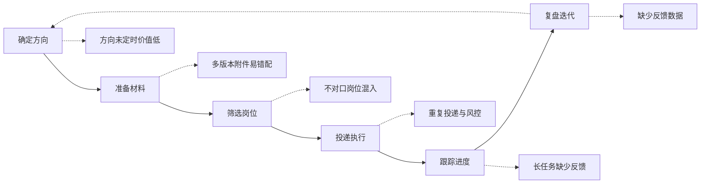

# 01 定位与用户

> 产品视角，不写个人使用经历。需求优先级见 [07-需求分析与取舍](07-需求分析与取舍.md)，
> 流程见 [02-业务流程](02-业务流程.md)，功能见 [03-功能结构](03-功能结构.md)。
> 不放真实投递数据，不引用个人能力库。

## 一、定位

**一句话**：面向多平台求职场景的本机工作台，把岗位采集、匹配判断、材料准备、投递执行、结果回写串成一条可追溯的流程。

价值主张不是「投得更多」，是**把有限的投递额度和注意力放到值得的岗位上**。额度受平台限制、时间受使用者限制，这两样都稀缺，所以「少投错的」比「多投几个」更接近问题本身。

产品边界（不是免责声明，是定义范围）：

| 不是 | 为什么划掉 |
| --- | --- |
| 在线服务或托管账号 | 登录态、附件、投递记录都留在本机，隐私和可控性优先于多端同步 |
| 简历代写或经历生成 | 附件材料由使用者提供，系统只做版本选择和发送，不制造事实 |
| 回复率承诺 | 系统控制的是投放质量，结果受岗位、材料、市场影响，不在可控范围 |
| 风控绕过工具 | 遇到风控页、投递上限、登录态失效就停，这是产品约束不是技术缺陷 |
| 通用自动化框架 | 只解决求职投递这一条链路，不做通用 RPA |

## 二、用户分层

目标用户按**使用方式**分，不按人口属性分。同一个人在不同阶段可能落进不同类。

| 类型 | 特征 | 核心诉求 | 主要使用路径 | 对应能力 |
| --- | --- | --- | --- | --- |
| 高频批量型 | 同时盯多个平台，单轮岗位量大，方向明确 | 减少重复操作，把额度用在值得的岗位上 | 配置条件 → 批量筛投 → 看进度 | 多平台采集、过滤、批量执行、实时进度 |
| 多版本材料型 | 跨方向投递，手上有多份附件材料 | 避免发错版本，缺版本时不投 | 维护版本映射 → 按方向选附件 | 附件版本管理、缺文件拦截 |
| 质量优先型 | 宁可少投，关键岗位愿意逐岗人工把关 | 不出现白发、重复、不对口的投递 | 人工门 → 待人工队列 → 逐岗确认 | 大厂转定制、人工门、严格跳过规则 |
| 复盘驱动型 | 关注哪类岗位值得继续投，会调整策略 | 有完整记录，能看出规则拦了什么 | 查记录 → 看跳过原因 → 调规则 | 投递记录、跳过原因、指标口径 |

表中「避免发错版本」是需求描述，实现口径见 [05-简版PRD](05-简版PRD.md) 的 R-09。

**明确不在服务范围内**：

| 人群 | 原因 |
| --- | --- |
| 方向未定、需要试错找方向的人 | 产品假设是「方向已定」，没有方向时过滤规则无从配置 |
| 投递量很低、每次都要深度定制沟通的人 | 配置和启动成本高于手工收益 |
| 期望无人值守长期运行的人 | 登录态、风控、平台规则变化都需要人介入，产品不承诺全自动 |

把不适用人群写进来，是为了让定位可被证伪。什么样的用户不该用，跟谁该用一样重要。

## 三、场景矩阵

| 阶段 | 核心任务 | 主要痛点 | 产品应答 | 优先级 |
| --- | --- | --- | --- | --- |
| 确定方向 | 定方向词与筛选条件 | 方向过宽会混入大量无关岗，过窄会漏岗 | 按平台分别配置，示例配置只做占位 | 高 |
| 准备材料 | 上传附件、建立版本映射 | 多版本容易错配，平台附件列表会掉 | 版本映射、缺文件不投、上传状态可见 | 高 |
| 筛选岗位 | 从搜索结果里挑值得投的 | 关键词搜回一堆不对口岗位 | 排除词优先、方向匹配、经验与学历硬要求、黑名单 | 高 |
| 判断与生成 | 决定投不投、写开场白 | 逐岗写话术耗时，模板话术回复差 | AI 判定 + 受约束的生成 + 确定性回退 | 中 |
| 投递执行 | 发送材料、控制频率 | 重复投递、风控、登录态失效 | 平台内去重、即时停止、降级路径 | 高 |
| 跟踪进度 | 知道当前跑到哪 | 长任务没有反馈，失败不易察觉 | 实时进度、消息推送 | 中 |
| 复盘迭代 | 回看结果与规则效果 | 只记投出去的，看不出哪些被拦 | 跳过也留痕、指标口径、版本化规则 | 中 |

优先级一列是排序结果不是功能状态，排序依据见 07。

## 四、用户旅程

旅程是闭环的：复盘结果会回头影响方向词、过滤规则和提示词，不是跑完一轮就结束。当前版本里这条回路主要靠人看记录来完成，自动化反哺属于后续候选，见 [08-路线图与风险合规](08-路线图与风险合规.md)。

## 五、价值主张与衡量方向

三条价值主张，各自对应一类可观察的结果：

1. **投放质量**：不对口的岗位在投前被拦下，白发和重复不占额度。
2. **可控性**：关键决策有人把关，异常会停，失败有确定性的回退。
3. **可追溯**：成功、失败、跳过都能查到原因，规则调整有依据。

北极星指标定为**有效投递占比**——通过全部规则、附件版本正确、结果可查的投递，占全部尝试的比例。指标树、输入指标与护栏指标见 07 第五节。本文不填数值，也不引用真实投递统计。

## 六、边界与合规

平台协议、账号风控、隐私、AI 生成对外话术的责任边界，集中在 [08-路线图与风险合规](08-路线图与风险合规.md)。非商业使用与上游协议见仓库根目录 `LICENSE`、`UPSTREAM.md`。
