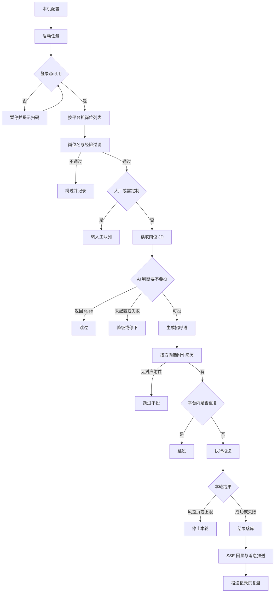
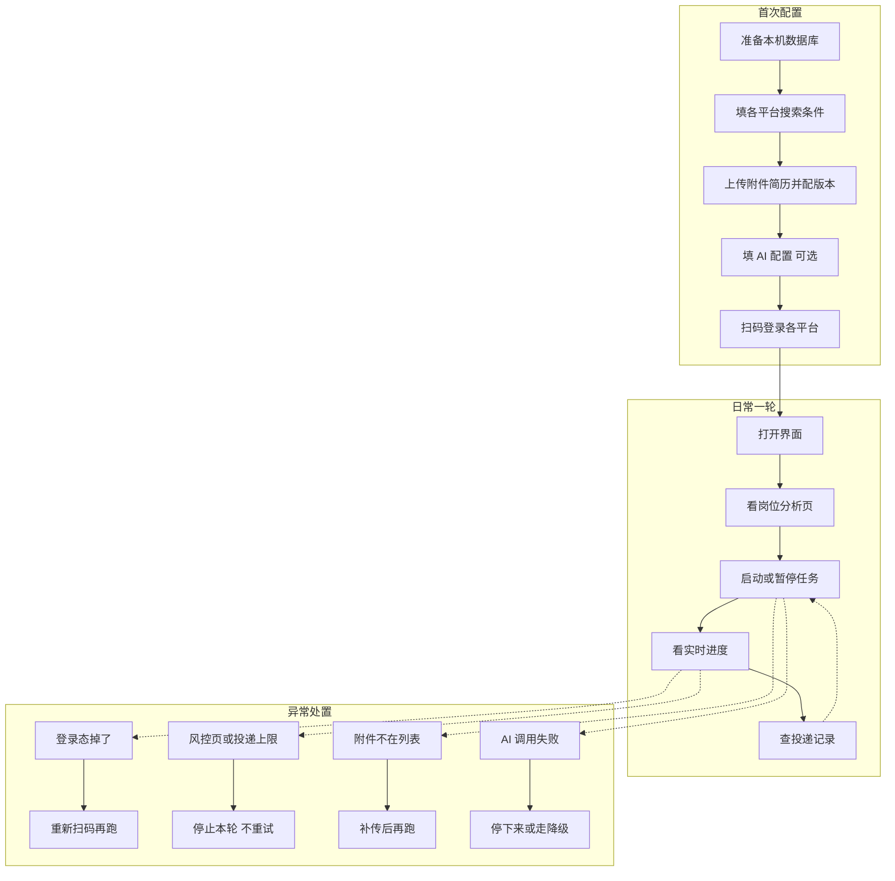

# 02 业务流程

> 图按当前代码的链路画。少数分支是设计口径，第 2 批 PRD 再逐条落规则，不在这里当既成事实写。
> 不放真实投递数据，不引用个人能力库。

## 一、业务流程图

主干是「配置 → 抓岗 → 过滤 → 判断 → 备料 → 投递 → 回写」。真正费事的不是主干，是旁边那一排跳过的分支：不匹配、没附件、重复、风控，都得有地方停下来，不然就变成闷头空转。

### 关键节点

| 节点 | 谁做 | 输入 | 输出 | 卡住了怎么办 |
| --- | --- | --- | --- | --- |
| 本机配置 | 人 | 搜索条件、附件简历、AI 配置、平台登录态 | 可启动的任务配置 | 没配完不启动，不拿默认值凑 |
| 登录态检查 | 程序 | 持久化浏览器数据 | 可用或不可用 | 不可用就暂停提示扫码，不反复重试 |
| 抓岗位列表 | 程序 | 平台搜索条件 | 岗位卡片 | 空结果就收尾，别当成没货一直刷 |
| 岗位名与经验过滤 | 程序 | 岗位名、经验要求 | 通过或跳过 | 排除词优先，命中直接淘汰 |
| 大厂判定 | 程序 | 公司名 | 自动投或转人工 | 转人工的岗不进批量队列 |
| AI 判断与招呼语 | 程序加模型 | 自我介绍、期望方向、岗位名、JD、参考话术 | 可投或 false，以及一段正文 | 没配模型或调用失败就降级或停，不让空话术发出去 |
| 附件选择 | 程序 | 当前方向与已上传附件 | 对应版本或空 | 找不到对应版本宁可不投 |
| 平台内去重 | 程序 | 平台、公司、岗位、沟通对象 | 可投或跳过 | 同一平台内重复一律拦下，跨平台不合并 |
| 执行投递 | 程序 | 招呼语、附件、页面会话 | 成功或失败 | 风控页、投递上限直接停本轮 |
| 结果落库与回显 | 程序加人 | 投递结果 | 记录、实时进度、消息推送 | 查不到记录按未投递处理，不补写成功 |

## 二、用户操作流程图

三段是分开的：首次配置做一次，日常一轮反复跑，异常处置随时插进来。别把异常当成流程末尾的一步，它会在任意节点打断，处理完回到原来那一步。

## 三、异常分支

| 异常 | 程序这边 | 人要做的 |
| --- | --- | --- |
| 登录态失效 | 暂停，提示重新登录 | 扫码，确认落地页对了再继续 |
| 撞上风控页或投递上限 | 停止本轮，不自动重试 | 等恢复，别换平台硬凑量 |
| 附件版本不在平台列表 | 跳过该方向，不投旧简历 | 补传对应版本再跑 |
| AI 没配置或调用失败 | 降级或停下，不生成空话术 | 查配置、查额度，确认后重跑 |
| 平台内重复投递 | 投前拦截，不占投递间隔 | 核对记录，别手工补投 |
| 岗位下线或已关闭 | 跳过并记录 | 不用管，别当成投递失败重试 |
| 数据库没有对应表或记录 | 不写成功状态 | 补表或补录后再复盘 |

表里「平台内重复」「不投旧简历」「不重试到解封」这几条是硬规则，不是建议。第 2 批 PRD 会把它们写成可测的业务规则。
