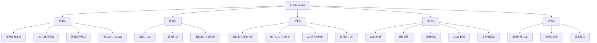

# 03 功能清单与结构

> 清单按仓库里现有的代码写，能对着路径查到，不列未实现的功能。
> 状态里「需人工」意思是程序不会代为执行，不表示没实现。

## 一、功能清单

### 配置层

| 功能 | 说明 | 代码位置 | 状态 |
| --- | --- | --- | --- |
| 平台搜索条件 | 各平台分别配关键词、城市、经验、薪资、行业、公司规模、活跃度 | `application/controller/ConfigController.java`、`front/app/*/page.tsx` | 已有 |
| AI 配置 | 接口地址、密钥、模型、自我介绍、生成用的 prompt | `AiConfigController.java`、`AiService.java`、`front/app/ai-config/page.tsx` | 依赖配置 |
| 环境变量 | 推送地址等本机配置 | `front/app/env-config/page.tsx` | 依赖配置 |
| 默认配置初始化 | 全新数据库第一次启动时灌入示例配置；已有配置不覆盖 | `init/DefaultPageConfigInitializer.java`、`defaults/page-config.json` | 已有 |
| 登录态 | 持久化浏览器数据与 Cookie 保存、清空、退出 | `CookieController.java`、`CookieService.java`、`worker/manager/PlaywrightManager.java` | 需人工扫码 |

### 数据层

| 功能 | 说明 | 代码位置 | 状态 |
| --- | --- | --- | --- |
| 岗位与 JD | 抓回来的岗位、JD 文本、公司、薪资、沟通对象 | `application/entity/*JobDataEntity.java`、各 mapper | 已有 |
| 投递记录 | 每轮投了什么、成功或失败、时间 | `application/mapper/*Mapper.java`、`front/app/records/` | 已有 |
| 黑名单 | 沟通不顺的公司记下来，后续跳过 | `BlacklistEntity.java`、`BlacklistMapper.java` | 已有 |
| 本机存储 | 单文件 SQLite，配置和数据都留在本机 | `application.yaml`、各 mapper | 已有 |

### 决策层

| 功能 | 说明 | 代码位置 | 状态 |
| --- | --- | --- | --- |
| 岗位名过滤 | 先看排除词，再看方向匹配词，命中才放行 | `worker/utils/JobRelevanceFilter.java` | 已有 |
| 智联专用过滤 | 去空格、硬排除优先、强方向信号白名单 | `worker/zhilian/ZhiLian.java` | 已有 |
| 经验与届别判断 | 明确要求工作经验、学历、项目年限的岗直接挡下 | 各 worker、AI prompt 规则 | 已有 |
| 大厂转人工 | 公司名命中名单就不自动投，留给人逐岗定制 | `JobRelevanceFilter.java` | 已有 |
| AI 判断投不投 | 拿自我介绍、期望方向、岗位名、JD 让模型判，不匹配只返回 false | `AiService.java`、`defaults/page-config.json` | 依赖配置 |
| 招呼语生成 | 生成一段能直接复制发送的正文，字数、格式、身份口径写在规则里 | `AiService.java`、`worker/boss/Boss.java` 的 `buildDefaultPrompt` | 依赖配置 |
| 人工审核门 | 需要人看一眼的环节，程序停下来等人 | `BossResumeFeatureService.java`、`front/app/resume-center/` | 需人工 |

### 执行层

| 功能 | 说明 | 代码位置 | 状态 |
| --- | --- | --- | --- |
| 平台投递链路 | 五个平台各自独立的抓取与投递实现 | `worker/service/*JobService.java`、`worker/shixiseng/Shixiseng.java` | 已有 |
| 附件简历 | 图片简历上传发送、按方向映射附件版本 | `BossResumeImageService.java`、`ZhilianController.java` | 需人工上传 |
| 平台内去重 | 投前按平台、公司、沟通对象拦重复，跨平台不合并 | 各 worker、黑名单 mapper | 已有 |
| 风控降级 | 登录态失效、风控页、投递上限时停止本轮 | `PlaywrightManager.java`、各 worker | 已有 |
| 回复检查 | 检查沟通回复 | `ReplyCheckController.java` | 已有 |
| 字体映射 | 附件生成时的字体对应表 | `ShixisengFontMap.java` | 已有 |

### 反馈层

| 功能 | 说明 | 代码位置 | 状态 |
| --- | --- | --- | --- |
| 实时进度 | 后端推送运行状态，前端订阅回显 | `application/controller/` 下的 SSE、`front/lib/sse.ts` | 已有 |
| 岗位分析页 | 按平台看抓回来的岗位与分布 | `front/app/*/analysis/`、`BossAnalyticsController.java` | 已有 |
| 投递记录页 | 全平台记录、Boss 记录、实习僧记录 | `front/app/records/`、`front/app/boss/records/`、`front/app/shixiseng/` | 已有 |
| 消息推送 | 企业微信机器人推送进展 | 环境变量里的推送地址、`worker/utils/Bot.java` | 依赖配置 |
| 健康检查 | 服务存活探测 | `HealthController.java` | 已有 |

## 二、产品功能结构图

五层是从下往上依赖的：配置和数据在下面，决策在中间，执行在下发，反馈回流到记录里。决策层最厚，因为大部分改进都花在「什么情况下不要投」，而不是「怎么把投递跑得更快」。

## 三、平台覆盖

| 平台 | 抓岗 | 招呼语 | 附件简历 | 记录页 | 备注 |
| --- | --- | --- | --- | --- | --- |
| Boss | 有 | 有，含 AI 生成 | 图片简历 | 有 | 人工门和大厂判定在这条链路最完整 |
| 智联 | 有 | 有 | 附件版本映射 | 有 | 带专用过滤规则 |
| 猎聘 | 有 | 有 | 图片简历 | 有 | 打招呼走平台侧设置 |
| 51job | 有 | 有 | 有 | 有 | 上游遗留链路，能力以代码为准 |
| 实习僧 | 有 | 有 | 附件简历 | 有 | 页面数据来自站点状态树，另带字体映射 |

差异是正常的，不追求五个平台长得一样。能投附件、能查记录、能停下来，这三条是共通的。

## 四、非目标

这些不在范围内，也不在路线图里：

- 在线托管、多人共用、账号代管；
- 代写简历、代编项目经历；
- 绕过风控、解封、无限重试；
- 无人值守长跑，登录态和风控都得有人看着；
- 复杂统计报表和可视化大盘。
