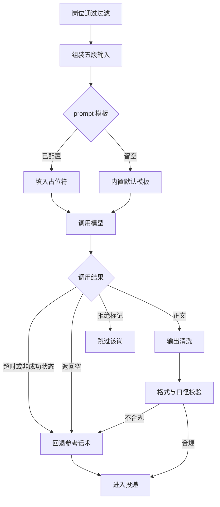

# 06 AI 功能设计与评估

> 第 2 批。AI 在这项目里只做两件事：判这个岗要不要投、写一段能直接发的招呼语。
> 指标只写定义和口径，测试用例只写场景和判据，**不放真实投递数据、不放统计数字、不引用个人能力库**。
> 用例里的输入一律是占位样本，不是真实岗位和真实自我介绍。

## 一、AI 做什么，不做什么

| 做 | 不做 |
| --- | --- |
| 拿自我介绍、期望方向、岗位名、JD 判「值不值得投」 | 编经历、编项目、编技能 |
| 不匹配时返回约定的拒绝标记 | 替人决定投哪家公司 |
| 匹配时写一段格式受约束的招呼语正文 | 自动回复 HR、自动谈薪资 |
| 输出做清洗和校验，不合规就回退 | 绕过风控、代替人登录 |
| 配置留空时走内置默认模板 | 把模型和密钥写死在代码里 |

边界划清楚才好评估。AI 出问题最坏的情况是发了一段不合适的话，不是把系统搞崩——所以评估重点在「输出能不能拦住」，不在模型有多聪明。

## 二、AI 流程图

图里 `G --> K` 那条是**现状**：模型没配好或者调用失败，回退到参考话术，岗位照投。这不是笔误。要不要改成「失败就停止投递」还没定，见 [05-简版PRD](05-简版PRD.md) 的开放项。

调用链对着代码写：`AiService` 从本机配置读地址、密钥、模型，按模型选接口形态，非成功状态时只对特定参数错误自动换一种接口重试一次，其余异常上抛；worker 层的 `generateAiMessage` 负责拼输入、识别拒绝标记、清洗输出，异常时回退参考话术。

## 三、输入与 prompt 结构

五段输入都从本机配置或抓回来的岗位里取，仓库里只放占位模板。

| 占位 | 来源 | 说明 |
| --- | --- | --- |
| 自我介绍 | AI 配置页 | 使用者自己填，默认配置里是占位文本 |
| 期望方向 | 平台搜索条件 | 当前这一轮的方向词 |
| 岗位名 | 岗位卡片 | 过滤通过后才有 |
| 岗位标签与 JD | 岗位卡片 | 城市、经验、学历标签加岗位描述拼成一段 |
| 参考话术 | 平台配置 | 模型失败时的回退文本，也是生成时的参照 |

模板本身写两类约束：先判断要不要投，命中硬要求就只返回拒绝标记；再写招呼语，字数、格式、身份口径、禁用词都写死。模板留空时走 `buildDefaultPrompt` 内置版本，两套规则口径要一致，别一处改了另一处没改。

## 四、输出约束与清洗

| 项 | 规则 |
| --- | --- |
| 判定输出 | 只返回拒绝标记或正文，不要解释、不要标点包裹 |
| 正文格式 | 一段话、纯文本、字数在模板给的区间内，不带表情符号和 Markdown |
| 开头结尾 | 去掉「以下是」这类客套前缀，去掉代码围栏和加粗符号 |
| 身份口径 | 照自我介绍和 JD 写，不自行编造身份、届别、到岗时间 |
| 自评词 | 不替对方下判断，禁掉「贴合」「一致」「契合」这类自评表述 |
| 实习表述 | 非实习岗清掉把自己锁死在实习时长上的说法，但保留正面的转正表述 |
| 数字 | 数字前面要说清那是个什么东西，不甩裸数字 |
| 兜底 | 清洗后仍不合规，回退参考话术，不把脏文本发出去 |

清洗规则不是随便加的，每一条都对应一种模型会犯的毛病。评估的时候按这些条目逐项打勾就行。

## 五、失败与降级

| 情况 | 处理 | 记什么 |
| --- | --- | --- |
| 没配模型 | 走内置默认模板或参考话术 | 配置状态 |
| 调用超时 | 回退参考话术 | 异常类型和原因 |
| 非成功状态 | 特定参数错误换接口重试一次，其余回退 | 状态码类别、不记密钥 |
| 返回空 | 回退参考话术 | 空返回 |
| 返回拒绝标记 | 跳过该岗 | 跳过原因 |
| 返回脏文本 | 清洗后再校验，仍不合规就回退 | 命中了哪条清洗规则 |
| 密钥或配置错误 | 不重试到锁号，提示去配置页 | 原因，不记明文密钥 |

## 六、评估指标

只写定义、算法口径和数据来源，不填数值，也不设阈值。

| 指标 | 定义 | 怎么算 | 数据来源 | 判读 |
| --- | --- | --- | --- | --- |
| 判定一致率 | 模型判投不投和人工标注一致的比例 | 一致条数除以标注样本条数 | 离线标注样本 + 试跑输出 | 越高越好 |
| 误放率 | 人工标为不该投却被判可投的比例 | 误放条数除以不该投样本条数 | 同上 | 越低越好，硬要求类应不出现 |
| 误拦率 | 人工标为可投却被判不投的比例 | 误拦条数除以可投样本条数 | 同上 | 越低越好 |
| 格式合规率 | 输出满足第四节全部格式条款的比例 | 合规条数除以生成条数 | 试跑输出 | 越高越好 |
| 幻觉率 | 出现编造经历、身份、数字的条数占比 | 命中条数除以生成条数 | 人工逐条读试跑输出 | 越低越好，理想情况不出现 |
| 清洗命中率 | 触发过至少一条清洗规则的生成占比 | 命中条数除以生成条数 | 试跑记录 | 用来观察模型稳定性，不是越低越好 |
| 降级可用率 | 模型异常时仍能给出可发送文本的比例 | 成功回退条数除以异常样本条数 | 故障注入的试跑 | 越高越好 |
| 单岗成本 | 一次判定加生成消耗的资源 | 按调用记录换算，不写具体数额 | 调用日志里的用量字段 | 用来选型，不单独判好坏 |
| 可追溯性 | 每条输出能否查到输入、模板、清洗结果 | 可查条数除以抽检条数 | 本机记录 | 越高越好 |

样本一律离线构造，标注由人来做。真实投递数据不进这张表，也不进评估报告。

## 七、测试用例

输入全部是占位样本。`预期` 写系统该怎么做，`判据` 写怎么算过。

| 编号 | 场景 | 输入 | 预期 | 判据 |
| --- | --- | --- | --- | --- |
| TC-01 | 明显不对口的岗 | 占位 JD，方向与自我介绍完全无关 | 返回拒绝标记，岗位跳过 | 记录页有跳过原因，无招呼语 |
| TC-02 | 要求工作经验 | 占位 JD 写明确年限 | 返回拒绝标记 | 不进入生成环节 |
| TC-03 | 非技术岗 | 占位 JD，岗位名命中排除词 | 过滤层直接淘汰 | 不调用模型 |
| TC-04 | 学历或项目年限硬要求 | 占位 JD 带硬要求 | 返回拒绝标记 | 不因措辞委婉而放行 |
| TC-05 | 方向匹配的岗 | 占位 JD 与自我介绍对得上 | 生成一段正文，格式合规 | 逐条对第四节打勾 |
| TC-06 | 输出带代码围栏 | 模型返回被 Markdown 包裹的正文 | 清洗成纯文本 | 无围栏、无加粗符号 |
| TC-07 | 输出带客套前缀 | 模型返回「以下是…」开头 | 去掉前缀 | 首句直接是正文 |
| TC-08 | 输出编造经历 | 模型正文里出现自我介绍没有的内容 | 判为幻觉，不合规则回退 | 不把编造内容发出去 |
| TC-09 | 输出带自评词 | 正文里出现禁用的自评表述 | 清洗或回退 | 最终文本不含禁用词 |
| TC-10 | 非实习岗带实习时长 | 正文写了每周到岗天数或实习月数 | 清掉该表述，保留正面转正表述 | 不把自己锁死在实习身份上 |
| TC-11 | 调用超时 | 断开模型服务后试跑 | 回退参考话术并记录原因 | 有记录，发出的文本不为空 |
| TC-12 | 返回空 | 模型返回空字符串 | 回退参考话术 | 不生成空招呼语 |
| TC-13 | 非成功状态 | 模型接口返回错误 | 特定参数错误换接口重试一次，其余回退 | 日志不出现明文密钥 |
| TC-14 | 模板留空 | 配置页清空提示词 | 走内置默认模板 | 两套模板口径一致 |
| TC-15 | 试跑一次 | 点试跑按钮 | 只生成，不投递 | 记录页无新增投递 |
| TC-16 | 密钥不落日志 | 跑一轮带失败的请求 | 日志有原因、无密钥明文 | 全文检索密钥占位值无命中 |

TC-11 到 TC-13 是故障注入，用离线桩或断网做，不拿真实岗位去试错。TC-15 是护栏：改完模板先试跑，再开投。

## 八、评估边界

- 不引用个人能力库，不放技能档位、能力话术和方向词清单；用例里只用占位。
- 不放真实投递统计，评估报告只写「哪条用例、什么样本、过没过」。
- 不跑全量、不刷平台，抓岗和模型调用都只做必要的样本量。
- 指标用来比较模板版本和模型选型，不用来对外承诺效果。
